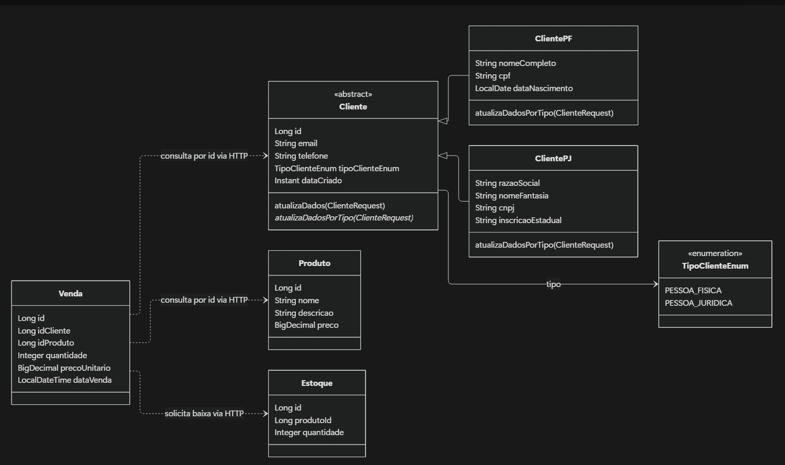
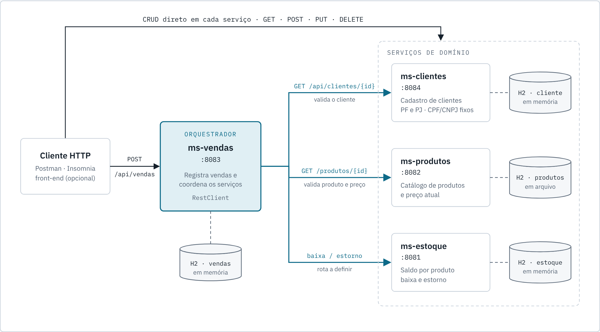
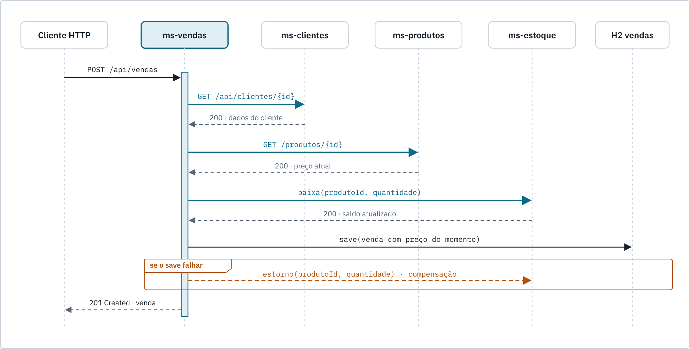

# Sistema de Vendas com Microsserviços

Repositório acadêmico desenvolvido com quatro aplicações Spring Boot independentes, responsáveis pelos domínios de clientes, produtos, estoque e vendas.

Cada microsserviço possui sua própria configuração, porta, banco de dados H2 e responsabilidades específicas. A comunicação entre os serviços ocorre por meio de APIs REST.

## Git Page

[Acesse aqui a git page do projeto](https://kaua281.github.io/trabalho-arquitetura-software/)

## Microsserviços

| Serviço | Porta | API disponível | Responsabilidade | Documentação |
| --- | ---: | --- | --- | --- |
| [`ms-clientes`](./ms-clientes) | `8084` | `/api/clientes` | CRUD de clientes pessoa física e jurídica. | [README de clientes](./ms-clientes/README.md) |
| [`ms-produtos`](./ms-produtos) | `8082` | `/api/produtos` | CRUD de produtos, com validação de entrada. | [README de produtos](./ms-produtos/README.md) |
| [`ms-estoque`](./ms-estoque) | `8081` | `/estoque` | Consulta, cadastro, atualização e controle de entradas e saídas de estoque. | [README de estoque](./ms-estoque/README.md) |
| [`ms-vendas`](./ms-vendas) | `8083` | `/api/vendas` | Registro e consulta de vendas, integrando os demais microsserviços. | [README de vendas](./ms-vendas/README.md) |

## Coleção do Postman

O projeto possui uma coleção do Postman para testar as APIs dos microsserviços, incluindo operações de cadastro, consulta, atualização, exclusão e cenários de erro.

A coleção pode ser importada diretamente no Postman:

[ARQ - Microsserviços.postman_collection.json](./docs/ARQ%20-%20Microsservi%C3%A7os.postman_collection.json)

As requisições utilizam variáveis de ambiente para definir os endereços dos serviços:

| Variável | Endereço |
| --- | --- |
| `baseUrlClientes` | `http://localhost:8084` |
| `baseUrlProdutos` | `http://localhost:8082` |
| `baseUrlEstoque` | `http://localhost:8081` |
| `baseUrlVendas` | `http://localhost:8083` |

## Tecnologias

- Java 21
- Spring Boot 4.1.2
- Spring Web MVC
- Spring Data JPA
- Spring Validation
- RestClient para comunicação HTTP entre microsserviços
- H2 Database
- Springdoc OpenAPI
- Maven

Cada microsserviço possui seu próprio `pom.xml` e Maven Wrapper.

## Executar

É necessário ter Java 21 instalado. Cada microsserviço deve ser iniciado separadamente, em um terminal próprio.

No PowerShell, a partir da raiz do repositório:

```powershell
cd ms-clientes
.\mvnw.cmd spring-boot:run
```

Para iniciar os demais serviços, abra outros terminais e execute:

```powershell
cd ms-produtos
.\mvnw.cmd spring-boot:run
```

```powershell
cd ms-estoque
.\mvnw.cmd spring-boot:run
```

```powershell
cd ms-vendas
.\mvnw.cmd spring-boot:run
```

Também é possível utilizar `mvn spring-boot:run` caso o Maven esteja instalado.

### Documentação das APIs

Cada serviço disponibiliza sua documentação Swagger UI:

| Serviço | Swagger UI |
| --- | --- |
| Clientes | `http://localhost:8084/swagger-ui.html` |
| Produtos | `http://localhost:8082/swagger-ui.html` |
| Estoque | `http://localhost:8081/swagger-ui.html` |
| Vendas | `http://localhost:8083/swagger-ui.html` |

Para registrar vendas, os microsserviços de Clientes, Produtos e Estoque também precisam estar em execução.

## Persistência e dados de demonstração

Cada microsserviço possui seu próprio banco H2 em memória, sem compartilhamento direto de tabelas entre os serviços.

| Serviço | URL JDBC |
| --- | --- |
| Clientes | `jdbc:h2:mem:cliente` |
| Produtos | `jdbc:h2:mem:produtos` |
| Estoque | `jdbc:h2:mem:estoque` |
| Vendas | `jdbc:h2:mem:vendas` |

Clientes e Produtos carregam dados de demonstração quando seus bancos estão vazios. Estoque utiliza o arquivo `data.sql` para inserir registros iniciais.

O microsserviço de Vendas não possui carga inicial de vendas.

Como os bancos são em memória, os dados são perdidos quando os processos são encerrados e recriados na inicialização dos serviços.

O console H2 está habilitado em `/h2-console` nos quatro microsserviços. Para acessá-lo, utilize a URL JDBC correspondente, usuário `sa` e senha em branco.

## Organização do código

Cada diretório `ms-*` representa um projeto Maven independente.

Os serviços seguem uma organização em camadas, com responsabilidades separadas:

- `controller`: disponibiliza os endpoints REST e define as respostas HTTP.
- `service`: implementa as operações e regras de negócio.
- `repository`: realiza o acesso aos dados utilizando Spring Data JPA.
- `model`: contém as entidades persistidas.
- `dto.request`: define os contratos de entrada das APIs.
- `dto.response`: define os contratos de saída das APIs.
- `client`: contém os componentes responsáveis pela comunicação com outros microsserviços, quando aplicável.
- `exception` / `exceptions`: contém as exceções e o tratamento de erros.

## Arquitetura e integração

O sistema é dividido em quatro microsserviços independentes, cada um responsável por um domínio específico.

O microsserviço de Vendas atua como orquestrador do processo de registro de uma venda, realizando chamadas HTTP para os demais serviços:

1. Consulta o microsserviço de Clientes para verificar a existência do cliente informado.
2. Consulta o microsserviço de Produtos para verificar a existência do produto e obter seu preço.
3. Solicita ao microsserviço de Estoque a baixa da quantidade vendida.
4. Registra a venda em seu próprio banco de dados, armazenando o preço unitário utilizado na operação.

O microsserviço de Estoque é responsável exclusivamente pelo controle das quantidades disponíveis, incluindo entradas, saídas e validação de saldo.

Cada serviço mantém seu próprio banco de dados e suas próprias transações. A comunicação entre eles acontece por APIs REST, sem acesso direto ao banco de dados de outro microsserviço.

Caso ocorra uma falha ao salvar a venda depois da baixa no estoque, o serviço de Vendas tenta realizar uma operação compensatória de entrada para devolver as unidades retiradas.

### Diagrama de classes



### Diagrama de arquitetura



### Fluxo de registro de venda

